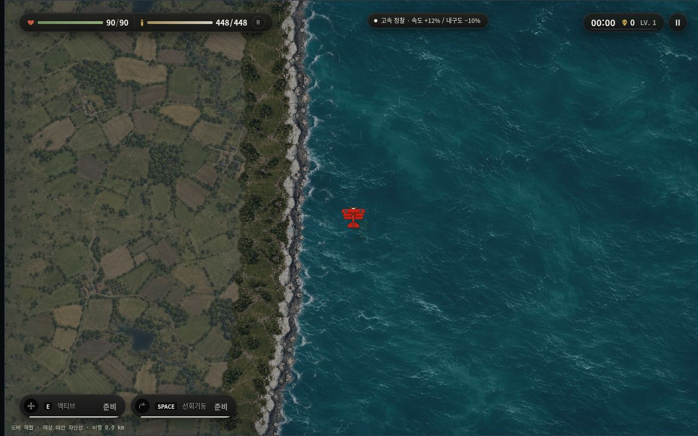
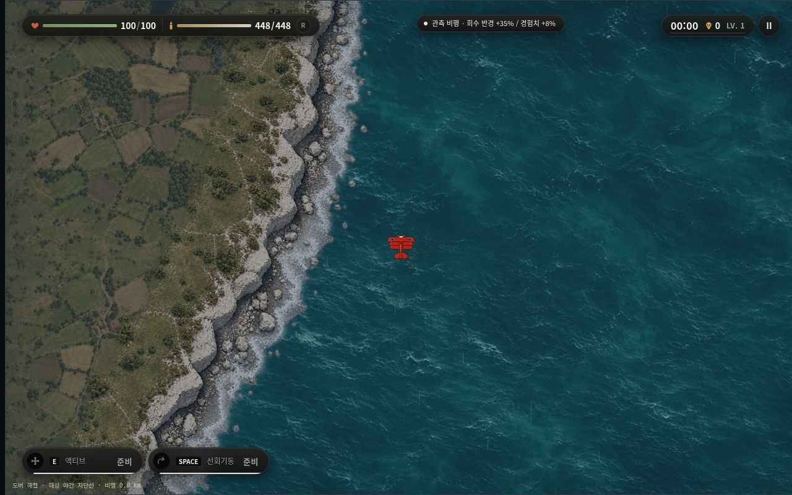
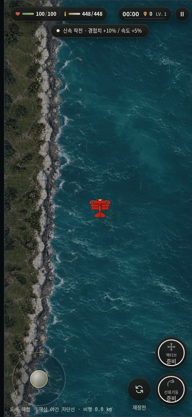
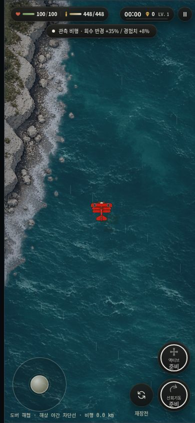
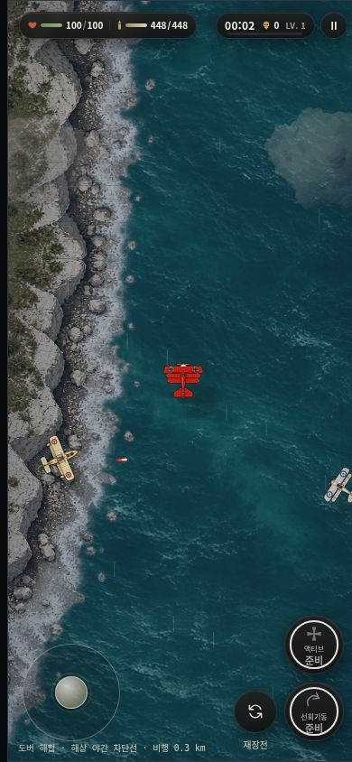
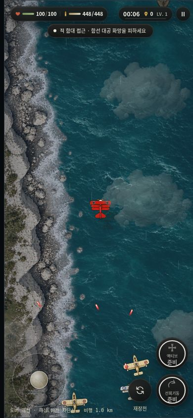
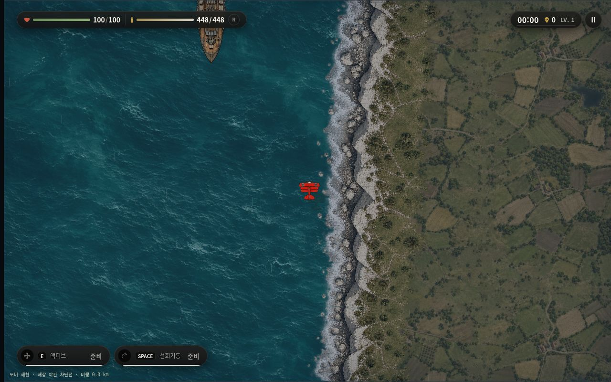

# 도버 해협 v6 — 실제 플레이 전후 비교

브랜치: `feat/dover-coast-visibility-fix`

소스 기준 main: `622a18395d0473fa0b57f45b7f88a1d3a89c9679`  
테스트 기준 main: `15bb188b18076595100c9cb928f33e6085163ddd`  
캡처 실행 코드: `6c894f95993b49f84dd1afcb18a1171b327f62f1` (최종 문서 커밋의 지형 코드와 동일)

이전 v5는 좁은 짙은 수풀 띠가 반복되는 모습이었고, 모바일 출격에서 절벽 면이 잘 보이지 않았다. 이번에는 백악 절벽·자갈 해안 원화를 다시 제작하고, 출격 지점 앞에 완만한 곶이 보이는 연속 해안선을 적용했다. 이동 중 확인된 얇은 가로선은 잘린 이미지 행 대신 전체 원화를 삼각형 클립 안에서 그려 제거했다.

| 확인 대상 | 결과 |
|---|---|
| PC 정상 출격 1280×800 | 농지 → 백악 절벽 → 자갈 해변 → 바다 연결 확인 |
| 모바일 정상 출격 390×844 | 첫 화면부터 왼쪽 절벽 확인; QA 위치 이동 없이 촬영 |
| 모바일 전진 2초 / 6초 | 해안 곡선·재질 이동과 가로 이음선 제거 확인 |
| 프랑스 해안 PC | QA 위치 이동으로 별도 확인; 선박은 바다 위에 표시 |
| 비행 영역 | 기존 6144×9216 유지; 해안만 출격 지점 가까이 배치 |
| 선박 영역 | 같은 해안 프로파일 사용; 항로 폭 2429–3047 월드 단위 유지 |
| 메시 검증 | 766 해안 구간에서 방향 뒤집힘 없음; 원화 픽셀 확대 없음 |
| 콘솔 | 확인한 실행 세션의 게임 오류 0 |

## 실제 캡처

PC 수정 전:

PC 수정 후:

모바일 수정 전:

모바일 수정 후:

모바일 전진 2초 / 6초:

프랑스 해안 별도 검사:

## 검증

- 도버 전용 테스트: **52/52 통과** ([로그](focused.log)).
- 테스트 리포지토리 전체: main 1123개 중 1122 통과 / 브랜치 1127개 중 1126 통과. 기존 `player-effects-import.test.mjs` 실패 1개 동일; 신규 실패 없음.
- 소스 리포지토리 전체: main 855개 중 533 통과 / 브랜치 859개 중 537 통과. 기존 실패 322개 이름 집합 동일; 신규 실패 없음.
- 소스 Worker 빌드 성공: 텍스트 235개, 이미지 229개. [빌드 로그](source-build.log).
- 테스트 리포지토리 빌드 검증: 문법 205개 모듈 확인. main과 동일한 기존 갤러리 참조 문제 7개로 전체 검증은 실패. [브랜치](public-build.log) / [main](public-base-build.log).
- 전체 검증 수치와 실패 목록: [검증 JSON](verification.json), [테스트 리포지토리](public-test-summary.txt), [소스 리포지토리](source-test-summary.txt).
- 최신 main의 비숍 폭탄, 파일럿, 지상전 연출, 기체 에셋 변경을 보존했다. 본 작업에서 뢰벤하르트나 다른 맵·보스 전투를 수정하지 않았다.

## 변경 파일

`app.js`, `dover-night-view.js`, `dover-patrol-chart.js`, `dover-terrain-profile.js`, `dover-terrain-render.js`, `index.html`, `stageboss-host.js`, `stageboss-view.js`, `test-lab.html`, `tests/dover-terrain-native.test.mjs`, `tests/dover-coast-visibility.test.mjs`, 신규 `terrain-dover-chalk-material-v6.webp`. 소스 리포지토리 런타임 파일은 `dist/` 아래 같은 경로이다. 검증 문서는 별도 폴더에 저장했다.

## 소재 제작과 남은 한계

ImageGen 도구로 기존 HEAD-ON 농지 재질과 백악 해안 원화를 참고하여 새 alpha 소재를 생성했다. 제작 방향은 정사영 탑뷰, 차분한 농지와 드문 관목, 읽기 쉬운 백악 절벽 면, 자갈 해변과 얇은 포말, 건물·선박·UI 제외, 양옆 실제 투명도였다. 생성 원본 887×1774 RGBA를 크기·픽셀 변경 없이 Sharp lossless WebP로 포장했다. Git blob: `9f3b1b1ed531861604683d4480d1a6a28539816b`.

지리적 해안선은 유한하며 연결 반복하지 않는다. 절벽 재질은 반사 반복하므로 장거리 이동에서 비슷한 바위·길 무늬가 다시 나타날 수 있다. 두 해안이 같은 원화를 사용하며 폭과 시작 위상을 다르게 적용했다. 실제 휴대전화 발열·GPU 성능은 측정하지 않았다. 로컬 소스 복구본의 기존 대용량 원화 두 개는 미수신 상태이므로 빌드는 수신된 자료 기준이며, GitHub 최종 트리에서는 기존 원본을 보존한다.

main 병합 및 본섭 배포는 하지 않았다.
